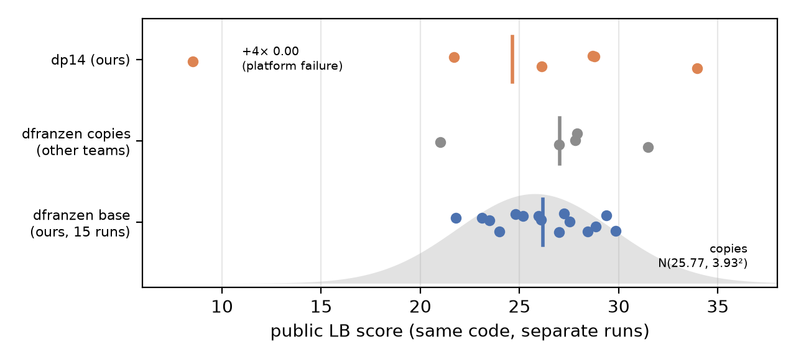
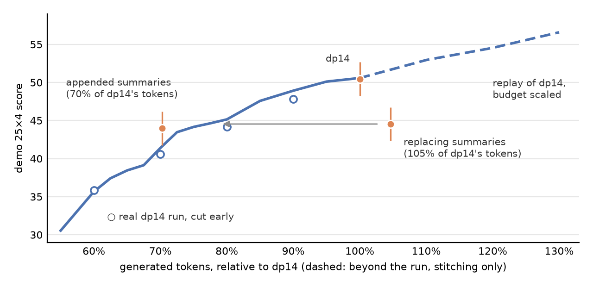

# Measuring Before Improving: Variance, Compute Allocation and Robustness in an LLM Harness for ARC-AGI-3

*Version 0.9 — 2026-11-07.*

Kazuhiro Nakada (Kaggle: kazuhiro3381)

Linked Kaggle submission: ARC Prize 2026 — ARC-AGI-3, submission 57374366 (2026-10-19, notebook `kazuhiro3381/arc3-dp14` version 1, public LB 33.96, the best of six scored runs): https://www.kaggle.com/code/kazuhiro3381/arc3-dp14?scriptVersionId=359191772 . The notebook is public (Apache-2.0); later versions 2–3 of the same notebook are a different agent (dp16) and were not this submission.

---

## Abstract

Most ARC-AGI-3 entries in 2026 are variants of one public LLM harness, and the leaderboard cannot tell them apart: identical code scored between 21.8 and 29.9 points across 15 of our own resubmissions. We make this precise and build tools that work around it. (1) We measure the noise at three levels — leaderboard resubmissions (SD ≈ 3.9 across public copies), local evaluation (SD 16.5 points per game across passes, ±3.1 points for the difference of two 100-run evaluations) — and derive the smallest improvement a single evaluation can detect (about 5 points). (2) We build an offline trajectory-replay simulator for the harness's compute scheduler. It reproduces a real 8-hour run to within 0.03 points and is used to test scheduling changes without GPU time. Its main finding is negative: scheduler tunings worth +3 to +4 points on the trajectories they were fitted to are worth 0 or less on held-out trajectories. (3) We show that inference throughput is a low-noise measure of compute, not of score, that takes one hour, and use it to raise throughput 10.5% (14 concurrent streams + host-memory hierarchical KV cache) before saturation. (4) We measure what memory costs: appended summaries doubled prefill and cut throughput 30%, but a prefix-stable design that removed this cost did not recover the score, because each action took 53% more tokens. Our own prediction failed, and throughput alone cannot judge memory. (5) We price compute by replaying the run under scaled budgets, at about 0.2–0.3 points per 1%: the appended design's loss needs no cause beyond compute, while the replacing design spent 105% of the tokens and scored like a 77% budget. (6) We document a platform failure mode (a 15-minute idle cut-off during slow model start-up) that turned four of our ten completed runs into 0.00, and a keep-alive fix that was verified only locally. Six local evaluations (the base and five changes) span 43.96 to 50.46 with an SD of 2.48, matching the measurement noise of ±2.2: none of our changes is distinguishable from the base. The submitted entry scored 50.46 locally (the best of six) and 33.96 on the public leaderboard (the best of six scored runs, mean 24.63).

## 1. Introduction

ARC-AGI-3 is an interactive benchmark: an agent plays unseen turn-based games, discovering their rules from pixels and feedback, and is scored by how many levels it clears and how efficiently (fewer actions than the human baseline). Unlike ARC-AGI-1/2, a single game can last hundreds of actions and an entry must run offline within 9 hours on one GPU.

By October 2026 the public frontier was a single lineage: Tufa Labs' "Duck" harness, extended by dfranzen into the Milestone-2 winning solution (Qwen3.8-Flash-Next, 4-bit, speculative decoding, an LLM that inspects the frame through a Python tool and chooses actions). Dozens of public forks differ by small patches. Their public scores (≈ 26–32) overlap almost completely.

This creates a measurement problem that matters for the whole field, not only for this competition: **when an agent is a long stochastic rollout of a large model under a fixed compute budget, how do you know whether a change helped?** Our contribution is not a new solver. It is a set of measurements and tools for answering that question in this setting, and the conclusions they force — several of them negative. We think these are useful to anyone trying to reach 85% on ARC-AGI-3, because the dominant cost of progress here is evaluation, and most proposed improvements are smaller than the noise.

**Inspiration.** The project started as an attempt to improve dfranzen's harness with a few targeted changes. Our first resubmission of the unchanged notebook scored 26.10; five more scored between 21.80 and 29.86. We stopped trying to improve the agent until we could measure it.

## 2. Prior work

- **Tufa Labs Duck harness / dfranzen Milestone-2 solution** (our base). We use it unchanged except for the components in §4. Its write-up reports several negative results we rely on: removing the structured world model helped, removing reasoning hurt badly, and summarization was "inconclusive". We add mechanism measurements on the last one (§6.4); its score effect stays unresolved.
- **shiiin9 D′** (Apache-2.0): a replacement for the priority formula that decides which game gets the next LLM slot. We adopt it.
- **Milestone-2 top-3 comparison** (Tong Hui Kang, Kaggle discussion 744792): the top three solutions share the harness and model and differ mainly in inference engineering (vLLM with 14 streams, hierarchical KV cache, UCB-style allocation). Their leaderboard order did not follow their throughput — an instance of the noise problem.
- **heliosli V6 / yukailiu**: persisting the Python interpreter state within a level. We evaluate it combined with other changes (§6).
- **Score-variance analyses** by skarin (local 4-pass evaluation; difference of 1.87 between pass-averages), Son Pham (distribution of LB scores of dfranzen copies, one submission per participant) and F. Liang (two identical 25×2 local runs; negative results for 14 streams and for a stall cut-off). We extend these to per-game variance and detectable effect sizes.
- **A. Provorov, "The Book of Ideas"** (Kaggle notebook and dataset, published 2026-10-30): 145 experiments on the same base, each placed against repeated runs of the unchanged program, with a 5-submission noise estimate, a split of where the attainable score is lost, and the cost of slow model loading. It reaches several of our conclusions independently (§5, §6.2, §7, §8). It does not replay the scheduler, test settings on held-out trajectories, or account for prefix-cache invalidation; and its 14-stream test ran without the host KV cache.

**Difference.** Previous work reports single scores of variants. We quantify the noise, build a simulator that separates scheduler effects from model stochasticity, and use mechanism-level diagnostics (cache, prefill, token flows) instead of scores to accept or reject changes.

## 3. Setting and evaluation protocol

- Hardware: one RTX Pro 6000 (96 GB), no internet, 9-hour limit. Hidden test set ≈ 110 games; public LB uses about half, private the rest, from the same run.
- Local evaluation ("demo 25×4"): the 25 public games, 4 independent passes each, played concurrently with the same per-game time budget as the real run (`max_runtime_s_per_game = 532·60·concurrency/110`). One evaluation costs ≈ 8 h 10 min of GPU, and we had one per week.
- Score: the official `arc_agi` 0.9.8 scorecard (level weights, per-level efficiency `min(115, (baseline/actions)²·100)`, best attempt per game).
- We never report scores on the training environments.

## 4. Approach

The submitted agent (`dp14`) is dfranzen's harness with:

1. **D′ scheduler** (shiiin9): the slot-allocation priority formula.
2. **14 concurrent streams** (was 10) with SGLang hierarchical KV cache in 32 GB host memory (`--enable-hierarchical-cache --hicache-size 32`; `MAXREQ=14`, CUDA-graph batch size 14).

The keep-alive of §7 came later and was never part of a scored run. The algorithm is unchanged otherwise: each game is a stream of LLM turns; each turn sees the recent history and a Python tool for analysing the frame; the model emits game actions; when the context reaches ≈117k tokens it is trimmed to ≈57k; the scheduler gives the next GPU slot to the game with the highest priority.

The rest of the paper is about how these choices were made and what was rejected.

## 5. Measuring the noise

### 5.1 Leaderboard

| Code | Public LB scores (each a separate full run) |
|---|---|
| dfranzen base, unchanged (ours) | 26.10, 28.84, 29.86, 23.98, 25.18, 24.80, 23.47, 21.80, 27.54, 27.26, 25.96, 26.98, 29.39, 28.44, 23.11 |
| dp14 (ours) | 33.96, 26.12, 28.69, 28.77, 21.70, 8.53 (+4 runs at 0.00 from a platform failure, §7) |
| Public copies of dfranzen (others) | mean 25.77, SD 3.93 |
| dfranzen base, unchanged (Provorov) | 31.73, 29.01, 25.37, 23.85, 28.04 (mean 27.6, SD 3.1) |

The unchanged base ranges over 8 points. An independent set of five unchanged submissions by Provorov shows the same spread (SD 3.1); his ten changed versions averaged 23.9, below the unchanged ones (Welch p = 0.07). To claim a +X improvement from one submission with 90% confidence requires X ≈ 1.28 × 3.93 ≈ 5 points; with four submissions, ≈ 2.5. This treats the copies' mean as a known control. Comparing two single submissions of unknown mean needs 1.28 × √2 × 3.93 ≈ 7 points, close to the 8 that Son Pham suggests.

*Figure 1. Public-LB scores of identical code across separate runs. Bars are means; the shaded curve is the distribution of public copies of dfranzen's notebook (mean 25.77, SD 3.93). dp14's mean over six scored runs is 24.63, 1.55 below our unchanged base (26.18, n=15). Without the 8.53 run (cause unknown; possibly a partial start-up failure) it is 27.85, +1.67 (Welch one-sided p = 0.23). The leaderboard shows no gain from the change that the local evaluation (§6.2) measured as +4.0, which is what §5.1 predicts for an effect of this size. Our reported 33.96 is the best of six draws.*

### 5.2 Local evaluation

Per game, the SD across the 4 passes averages **16.5 points** (root mean square 22.0, which is what sets the standard error). Matched per-game differences between two versions swing ±50 (e.g. one game −51.7, another +31.2) while the averages differ by only −1.73. Propagating per-game variance gives a standard error of ≈ ±2.2 points for one demo-25×4 average and **±3.1 for the difference of two**. An independent measurement agrees: Liang ran the unchanged notebook twice (25 games × 2 passes) and found a per-game SD of 24.0 for the difference; for two-pass means our RMS of 22.0 predicts 22. Provorov reports the same effect at the level of a whole test: identical code cleared 54 and 45 of 72 levels in two 30-minute runs on ten public games.

Consequence for a decision rule "accept if mean ≥ baseline + 2": a change with zero true effect is accepted ≈ 26% of the time; a change with a true +2 effect is accepted only ≈ 50%. **One weekly evaluation can only resolve ≈ 5-point effects** (1.645 × 3.1 at 95% one-sided; 4 points at the 90% used in §5.1). This determined our strategy: prefer candidates that are large if they work, and use cheaper, lower-noise proxies (§6.2) whenever possible.

The six evaluations show what this means in practice. Five are ours. The base row is dfranzen's own v3 evaluation under the same protocol, read from the 100 run records in skarin's audit notebook, so we have no server logs for it.

| Evaluation | Change from base | Mean | Actions | Generated tok/s |
|---|---|---|---|---|
| base | none | 46.49 | — | — |
| `t06` | temperature 0.6 | 44.77 | 20,630 | 593 |
| `dprime` | D′ | 47.84 | 20,731 | 592 |
| `dp14` | D′, 14 streams, host cache | 50.46 | 21,166 | 639 |
| `dp14pysum` | + appended summaries | 43.96 | 14,415 | 449 |
| `sumtrimB` | + replacing summaries | 44.54 | 14,432 | 671 |

**Their SD is 2.48, against ±2.2 expected from pass noise alone (χ² = 6.34, 5 df, p = 0.28).** The six means are consistent with one common value: no change we tried is distinguishable from the base. Paired by game, `dp14` minus D′ is +2.6 (95% CI −2.4 to +7.8). Mechanism measurements (actions, throughput, prefill) do separate these runs clearly, which is why §6 relies on them.

## 6. Results

### 6.1 Offline replay of the scheduler (negative result)

Most remaining headroom appeared to be in allocation: tokens were spread almost uniformly over games (1.5–7.7% each), the five games averaging under 3 points consumed 9.6% of all tokens, and won runs already scored 98.4 on average. We therefore asked whether a better allocation formula exists, without spending GPU.

**Simulator** (`sim/`). A trajectory is the sequence of LLM requests of one run (generated tokens, uncached input tokens, context trims) and the points where levels were cleared. We assume a game's progress depends only on tokens and actions consumed, not on wall-clock time. Request duration is fitted as

  `t = 5.2 s + generated/59 + uncached_input/2100`  (R² = 0.97 on 4,000 steps).

We replay the scheduler with 14 slots and the real time budget and score with the official formula. Runs cut off by the deadline are extended by **stitching**: the continuation is drawn from other passes of the same game from the same level onward (including passes that never cleared it, so success rates are preserved).

**Validation.** Replaying D′ without stitching gives 50.43 (actual 50.46); 99 of 100 runs reach the same number of levels; the median error in the time of the last level-up is 5 minutes. With stitching, the reference for every comparison below, D′ gives 50.61. Replaying the original dfranzen formula gives 47.90, consistent in sign with the measured D′ gain (replayed +2.7, measured +1.35, which is inside the noise).

**Findings.**
- A greedy oracle that knows each trajectory's future reaches 53.33, against 50.61 for D′ with the same stitching: even perfect allocation is worth only ≈ +2.7 on these trajectories. Cutting the budget by 10% costs D′ 1.6 points and the oracle 0.6; larger cuts cost far more (§6.5).
- On the `dp14` trajectories, individual tweaks (linear floor 0.3, token scale 450k, headroom on the final level) each gain ≈ +2, and the best random-search settings gain **+3 to +4** (18 of 20 bootstrap game resamples positive).
- **On held-out trajectories from two other evaluations, the same settings gain 0 or less** (best setting: +3.6 on `dp14`, −2.6 and −1.3 on the others). Those two evaluations kept no request logs, so their per-request timing is approximated from generated tokens; their actions, tokens and level clears are real. Only one tweak was non-negative on both (+0.2 / −0.1).

**Conclusion.** With 100 trajectories, a scheduler can be fitted to the trajectory noise. We rejected all allocation changes. The general lesson: offline replay is accurate enough to *reproduce* a run, but evaluation of a policy on the same trajectories it was tuned on is as misleading here as training-set accuracy.

### 6.2 Throughput as a low-noise proxy

Throughput (generated tokens/s) varies little between runs and can be measured in 60 minutes, while score needs 8 hours and is noisy. We screened server configurations by throughput first (demo 25×4, 60 min each).

| | base (10 streams) | 14 streams + host KV cache 32 GB | 16 streams + host KV cache |
|---|---|---|---|
| Generated tokens/s (harness) | 563 | **622 (+10.5%)** | 633 (+1.8% over 14) |
| Actions in 60 min | 2,262 | 2,977 | 2,938 |
| Mean concurrent requests | 9.3 | 11.4 | 12.6 |
| Mean KV utilisation | 0.54 | 0.65 | 0.78 |
| Server queue non-empty | 4% | 91% | 50% |
| Prefix-cache hit rate | 93% | 91% | 89% |

Beyond 14 streams the GPU saturates (KV utilisation near its limit), so we stopped there. The host-memory cache appears to be what makes 14 streams pay. Liang raised the stream count from 10 to 14 *without* it and lost 17 points (29.90 vs 47.30); generated throughput fell from ≈610 to ≈280 tok/s late in the run as growing contexts no longer fit in GPU KV memory. That run was on a different machine with slower disk, so the comparison is suggestive, not controlled. Provorov's leaderboard test points the same way: 14 requests *without* the host cache scored 21.49, against 28.04 for the unchanged base submitted the day before, although a bench without games had shown +10.5% throughput. Both reports of 14 streams without the host cache lost; we know of no report of 14 streams with it other than ours. A single leaderboard run is inside the noise of §5.1, so this is consistent evidence, not proof. Combining 14 streams with D′ (each estimated at +1 to +2 alone) produced `dp14`: **50.46** on demo 25×4 vs. 46.49 for the base and 47.84 for D′ alone — the only change that cleared our acceptance line. That is the best of six evaluations (§5.2), and the leaderboard does not confirm it (Figure 1), so the score gain is unproven; the throughput gain is measured. Throughput measures compute, not score: the fastest evaluation of all (671 tok/s, §6.4) scored 44.54. §6.5 gives the exchange rate between the two.

### 6.3 Where the tokens go

On the `dp14` evaluation (18.84M generated tokens):
- **7.6%** of tokens were 120 responses that hit the 12,288-token output cap with no tool call and no answer (median 35k characters of reasoning about frame changes; not repetitive — compression ratio 0.32). 119 of 120 were followed by another non-action. Worse, the dead reasoning was re-sent as input 2.7 times on average (4.03M input tokens).
- No-op actions: 2.2%; exact state-action repeats: 0.04% (so repeat guards are pointless).
- Eliminating all capped responses would raise the replayed score from 50.61 to 52.30 (upper bound **+1.7**).
- **96 of 100 runs hit the context limit** (first at the median 37th request); 388 trims each discard ≈59k tokens of interpretation (115k to 56k at the median). Unsolved runs were trimmed more (4.5 vs 2.7 times) — correlation, not causation.

### 6.4 What summarization actually costs (mechanism, and a failed prediction)

Context loss at trimming looked like the obvious bottleneck, and the harness supports summaries that are kept in the history. We evaluated two designs on top of `dp14`, both with Python-state persistence.

- **Appended** (`dp14pysum`): a summary every 24k tokens, added near the end of the history, with two cheap fixes (stub dead reasoning; prefer tool calls).
- **Replacing** ([`sumtrimB`](https://www.kaggle.com/code/kazuhiro3381/arc3-sumtrimb), public notebook, version 3): a summary every 57k tokens that replaces the history, at about the point where a trim would rebuild the prefix anyway; the two cheap fixes are off.

| | dp14 | appended | replacing |
|---|---|---|---|
| Demo 25×4 mean | 50.46 | **43.96** | **44.54** |
| Levels cleared / runs won | 431 / 33 | 348 / 33 | 375 / 30 |
| Actions | 21,166 | 14,415 | 14,432 |
| Generated tokens | 18.84M | 13.24M | 19.70M |
| Generated tokens per action | 890 | 918 | **1,365** |
| Generated tokens/s | 639 | 449 | **671** |
| New prefill tokens | 60.6M | **122.1M** | **60.5M** |
| Prefix-cache hit rate | 91% | 80% | 84% |
| Generation of games that lost ≥10 points, vs. `dp14` | — | 49% | 90% |

**Appended summaries are a compute trap.** The summaries themselves were good (3–5 per final history, 5–8k characters; 85% of turns carried one), and the dead-reasoning fix worked (−62% output-cap hits on 37 matched runs). But each summary changes the prefix every 24k tokens: cache hits fell from 91% to 80%, prefill doubled and throughput fell 30%. Summary tokens also count toward a game's consumption and lower its scheduler priority, so games that lost ≥10 points received 49% of their `dp14` generation and games that gained ≥10 received 123%. We concluded that compute explained the loss, and predicted that a design keeping the prefix stable would recover the score.

**The prediction failed.** The replacing design removed the whole compute cost: prefill returned to 60.5M, throughput reached the highest of any evaluation, and the games that lost ≥10 points kept 90% of their generation, so nothing was starved. The score still stayed at 44.54. Actions fell by the same 32%, for a different reason: each action took 53% more generated tokens. Summaries are not that difference: the 469 summaries total 3.35M characters, ≈5% of generated tokens (their hidden reasoning is not logged).

**Theory.** Under a fixed compute budget a memory mechanism has two prices. Mutating a long shared prefix is paid in prefill, and the price is not the summary's length but the re-prefill it forces. Compressing the history is paid in re-checking. We tested this by reading the request logs of 97 runs, matched to `dp14` by game and pass:

| Matched runs | dp14 | replacing |
|---|---|---|
| Tokens per action, context < 50k, before the first replacement | 1,018 | 1,049 (+3%) |
| Tokens per action, afterwards | 923 | **1,469 (+59%)** |
| Requests per decision, before / afterwards | 1.87 / 2.11 | 1.92 / **2.98** |
| Tokens per request, afterwards | 2,160 | 2,279 (+6%) |

The two runs behave alike until the first replacement and diverge after it. A replacement cuts the context from ≈65k to ≈8k tokens, every 17 requests at the median. `dp14`'s trims are just as frequent (every 18.5 requests) but keep ≈56k tokens of verbatim history, so what differs is how much evidence survives, not how often the context is rebuilt. The summaries are careful, but the model does not simply trust them:

| Share of responses opening with re-grounding language | replacing | appended |
|---|---|---|
| Before the first context drop | 8.6% | 8.6% |
| First response after a drop | **85.1%** | 7.2% |
| Responses 2–4 after a drop | 21.0% | 8.0% |
| Later | 9.6% | 8.7% |

(A pattern match on the first 400 characters of reasoning, e.g. "re-ground", "re-orient", "re-read", "summary says", "let me verify". All five responses we drew at random and read in full did this: they restate the summary and check it against the frame before acting.) Requests that execute no action rise from 11% before the first replacement to 29% after it: 36% just after a replacement, and still 23% twenty requests later. With the appended design they stay at 15–21%, with no peak.

The re-grounding spike is the visible part, not the bulk. Of ≈6.5M excess tokens, the longer responses just after a replacement account for ≈14%. About 90% is extra requests, not longer ones: the model keeps inspecting between actions.

Three limits apply. The appended design has the same Python persistence and no excess (918 tokens per action), so persistence does not cause the extra tokens, but it was never evaluated alone for score. `dp14`'s text is no longer available, so the text control is the appended design, not `dp14`. And we show what the tokens were spent on, not that re-checking lowered the score. The robust conclusion is that removing a mechanism's compute cost does not show that the mechanism helps, and throughput cannot judge memory.

**How sure are we?** Neither drop is established. Against `dp14`, a game-level bootstrap gives −6.51 (95% CI −15.2 to +0.9) and −5.93 (−13.2 to +1.6), and `dp14` is the best of six evaluations (§5.2), so these differences are biased upward in size. Against the base they are −2.5 and −2.0. What is measured precisely is the mechanism (prefill, throughput, tokens per action), not the score effect.

### 6.5 What a compute budget buys (post-hoc analysis)

Actions obey an identity: `actions = time × r / c`, with r generated tokens per second and c generated tokens per action. Against `dp14`, r/c falls by 32% for the appended design (r: 449 vs 639) and by 32% for the replacing design (c: 1,365 vs 890), which is why they made the same number of actions by different routes. To price that loss we replayed `dp14` under D′ with the deadline scaled (`analysis/budget_curve.py`). The scheduler knows the new deadline, and each point averages five nearby deadlines and three stitching seeds, because the replay is chaotic in the budget.

| Budget (relative to `dp14`) | 60% | 70% | 80% | 90% | 100% | 110% | 130% |
|---|---|---|---|---|---|---|---|
| Replay | 35.66 | 41.39 | 45.14 | 48.92 | 50.58 | 52.94 | 56.58 |
| The real `dp14` run, cut at that time | 35.81 | 40.60 | 44.17 | 47.80 | 50.46 | — | — |

The replay and the real run cut early agree within 1.1 points, with no fitting. Above 100% the curve rests on stitching alone and is unvalidated.

*Figure 2. What a budget buys. The line is the replay of `dp14` with a scaled deadline (dashed above 100%: stitching only); open circles are the real run cut early; bars are ±2.2 for one evaluation. The appended design sits on the curve. The replacing design spent more tokens than `dp14` and scored like a 77% budget (arrow).*

**Compute is far from saturated.** A cut of 10% costs 1.7 points, 20% costs 5.4, 30% costs 9.2 and 40% costs 14.9. This corrects an earlier draft, which read "−10% costs 1.6" as a sufficient budget. Allocation has little left (§6.1), but total compute does not: it is worth about 0.2–0.3 points per 1%. Two consequences follow. The measured +10.5% throughput (§6.2) is worth ≈ +1.5 points, far below what one evaluation can see, and close to the +1.67 of Figure 1 (which proves nothing by itself). And a visible 5-point gain corresponds to ≈ 20–25% more effective compute.

| Against the replay of `dp14` at | Budget | Replay | Actual | Gap (95% CI, game bootstrap) |
|---|---|---|---|---|
| Appended, equal tokens | 70% | 41.62 | 43.96 | +2.3 (−3.7 to +8.1) |
| Replacing, equal tokens | 105% | 51.65 | 44.54 | −7.1 (−14.7 to +0.7) |
| Appended, equal actions | 62.5% | 37.42 | 43.96 | +6.5 (−1.7 to +16.3) |
| Replacing, equal actions | 62.5% | 37.42 | 44.54 | +7.1 (−3.3 to +19.0) |

**The appended design's loss needs no cause beyond compute.** At 70% of the tokens the replay predicts 41.62 and the design scored 43.96. So our first explanation (§6.4) stands for that design; what failed was its extension to the prediction that a prefix-stable design would recover the score. Without the simulator the check points the same way: the three evaluations without memory, cut at 13.24M tokens, stand at 39.70, 38.69 and 40.60 (below the replay, because a run cut early never reached its end-game scheduling).

**The replacing design paid the same bill elsewhere.** It spent 105% of the tokens and scored what `dp14` would score with 77%. It lies between its two bounds: if re-checking tokens were worth nothing it would sit at the equal-actions value (37.42), and if they were worth as much as `dp14`'s it would sit at the equal-tokens value (51.65). The point estimate is about half way.

**Limits.** We did this after seeing the results. Every interval includes zero. `dp14` is the best of six evaluations, so the curve is probably too high by a few points, which would widen the appended design's lead and narrow the replacing design's deficit. The curve assumes that progress depends only on tokens and actions, and that tokens removed from one design would be worth what they were worth in `dp14`. Equal actions uses the replay's action count, which is approximate where runs were stitched.

### 6.6 Other rejected changes

| Change | Result |
|---|---|
| Temperature 0.7 → 0.6 (vendor recommendation) | 44.77 vs 46.49 (Δ −1.73, t = −0.43: indistinguishable) |
| D′ alone | 47.84 (+1.35, below the line) |
| 16 concurrent streams | +1.8% throughput only |
| Scheduler coefficient tuning | overfit (§6.1) |
| Appended summaries | 43.96; prefill ×2 (§6.4) |
| Replacing summaries | 44.54; tokens per action +53% (§6.4) |

## 7. Robustness: a platform failure that scores zero

From mid-October, model loading on the evaluation machines slowed from ≈5 to ≈35 minutes (reports by several teams). The gateway ends a run after **15 minutes without an action** and records the current score as final. The base harness waits 12 minutes for the server, sends one RESET and then waits; with a 40-minute start-up the run is cut off with zero actions and is reported as a successful 0.00. Four of our ten `dp14` submissions scored exactly 0.00 this way. Each 0.00 result file is 3,411 bytes, the same size other teams report for their 0.00 runs (scored runs: 3,775–3,892 bytes). The failure is not specific to our changes: Liang reports 2 of 12 submissions returned as successful 0.00, one of them the unmodified notebook. Provorov measured the load time directly: from 23 October, 17 of 31 model loads took more than 17 minutes, and an unprotected resubmission of a notebook that had scored 29.89 ended after 30 minutes at 0.00.

**Fix (keep-alive).** The game that holds the first slot re-sends RESET every 9 minutes until the server's `/health` returns 200, through the same code path as the original RESET, so the single shared scorecard is preserved; it stops as soon as a real action is taken. The HTTP grace period was raised from 900 to 5,400 s, and the notebook waits up to 20 minutes for input datasets to mount. On a normal day the server is up before any game starts and nothing changes. We verified the behaviour with a stub harness (14 concurrent games; exactly one keep-alive game; RESETs stop after health). All four leaderboard submissions of the keep-alive version (2026-10-25 and three on 2026-10-27) failed before any code ran, while mounting datasets; on 2026-10-27 the `dp14` version mounted normally one hour later. Because the failure follows the notebook version and not the day, we attribute it to that version's stored state. A rebuilt version under a new slug was pushed on 2026-10-31 but not submitted before the deadline. **The keep-alive is therefore verified only by the stub test, never by a scored run.**

## 8. Discussion: what this implies for reaching 85%

- **Evaluation is the bottleneck.** With per-game SD ≈ 16.5, a change must be worth ≈5 points to be seen in one 8-hour evaluation. Most published tweaks are worth 1–2. Progress requires either more evaluations, held-out game sets (e.g. independent parametric game collections), or mechanism-level proxies such as throughput and token accounting.
- **Allocation is nearly exhausted** in this harness: even a future-knowing oracle gains only ≈ +2.7, and apparent scheduler gains are fitted noise. **Total compute is not:** it is worth ≈ 0.2–0.3 points per 1% (§6.5), so a replay curve turns a mechanism measurement into a predicted score, without the noise of an evaluation.
- **The remaining headroom is in solving ability**, i.e. what the model learns per token — not in how tokens are distributed. Provorov's split of 132 runs agrees: 46.5% of the attainable score lies in levels never reached, 10.5% in the level where the run stopped and only 2.5% in extra actions on cleared levels; and 93% of level clears happen within the first 70,000 tokens spent on the level. Memory mechanisms must be judged by what they cost in prefill and in reasoning per action, not by the information they keep or their length.
- **Robustness is part of the score.** A long-start-up failure turned a 30-point agent into 0.00 four times out of ten; harnesses should treat platform latency as an adversary.

**Universality.** The noise analysis, the replay simulator with stitching, and the cache-cost argument apply to any LLM agent run under a fixed GPU budget with long shared contexts.

## 9. Conclusion

We did not build a new ARC-AGI-3 solver. We measured how much the dominant public solver's scores vary, built a simulator that replays its scheduler to within 0.03 points, and used these to test our own changes. None of the five changes is distinguishable from the base by score, including the one we submitted, whose throughput gain is real but whose score gain the leaderboard does not confirm. Scheduler tuning turned out to be overfitting. Appended summaries are a compute trap, and removing that trap did not bring the score back, which falsified our own prediction: the same budget went to re-checking instead of prefill. Allocation is nearly exhausted, but total compute is not, at 0.2–0.3 points per 1%. A keep-alive addresses a 0-point failure mode but was never verified in a scored run. The main message is methodological: on ARC-AGI-3 today, **most proposed improvements are smaller than the noise, so judge a change by the mechanism you can measure, and let your predictions fail.**

## Reproducibility and license

- Code: notebooks and tools in https://github.com/cacco2010-maker/arc3-measuring-before-improving : `_make_nb.py` (variant generator), `sim/` (replay simulator: `build_dataset.py`, `timing.py`, `sim.py`, `search.py`, `eval_all.py`), `analysis/` (`memory_cost.py` for §5.2 and §6.4, `budget_curve.py` for §6.5), `_keepalive_cell.py`, `_no_trial_cell.py`.
- License: the Kaggle notebook is public under Apache-2.0 (Kaggle's licence for public notebooks); our tools outside it CC0, except the third-party formulas re-implemented in `sim/` (Apache-2.0; see NOTICE in the repository).
- Third-party code:
  - dfranzen's harness patches and serving builder: Apache-2.0 (github da-fr/arc-agi-3-solution, a fork of Tufalabs/duck-harness). The Kaggle copies (`dfranzen/taaf-kaggle-source-bundle-copy`, `dfranzen/pennyroyal-v253`) are listed as "unknown"; the wheelhouse states that bundled packages keep their upstream licenses.
  - Tufa Labs Duck harness: the upstream repository (checked 2026-10-26) has no license file and no license statement in any README. The competition rules require prize-winning code to be released under CC BY 4.0, and the harness was released as Tufa Labs' Milestone-1 prize code, so we treat it as CC BY 4.0 with attribution. Tufa Labs has not confirmed this.
  - D′ (shiiin9): Apache-2.0.
- Model weights (not our code): Qwen3.8-Flash-Next, Intel AutoRound W4A16, resharded by dfranzen, plus the albucino MTP draft head. All are under the Qwen Community License 1.0 (`qwen-community-1.0`), as stated on the Kaggle Models pages.

## References

1. ARC Prize Foundation. ARC-AGI-3. https://arcprize.org/arc-agi/3 ; ARC Prize 2026 — ARC-AGI-3 (Kaggle). https://www.kaggle.com/competitions/arc-prize-2026-arc-agi-3 ; scoring package `arc-agi` 0.9.8, https://pypi.org/project/arc-agi/0.9.8/
2. Tufa Labs. Duck harness. https://github.com/Tufalabs/duck-harness
3. D. Franzen. ARC-AGI-3 Milestone 2 Solution (Kaggle notebook). https://www.kaggle.com/code/dfranzen/arc-agi-3-milestone-2-solution ; write-up and code: https://github.com/da-fr/arc-agi-3-solution
4. shiiin9. D′ priority scheduler, "31.54 in a Single Submission" (Kaggle notebook, v2). https://www.kaggle.com/code/shiiin9/affectify-arc-31-54-in-a-single-sub
5. T. H. Kang. Comparison of the Milestone-2 top-3 solutions (Kaggle discussion). https://www.kaggle.com/competitions/arc-prize-2026-arc-agi-3/discussion/744792
6. heliosli. "Try merging it" (V6, Kaggle notebook). https://www.kaggle.com/code/heliosli/try-merging-it-you-might-get-lucky-and-win-gold ; Y. Liu. ARC-AGI-3 Champion Solution (Kaggle notebook). https://www.kaggle.com/code/yukailiu/arc-agi-3-champion-solution
7. skarin. ARC-AGI-3: 27.80 LB | 100-Trajectory Audit (Kaggle notebook). https://www.kaggle.com/code/skarin/arc-agi-3-27-80-lb-100-trajectory-audit
8. Son Pham. "Incredible notebook performance variation (Daniel Franzen's copies data analysis)" (Kaggle discussion, 2026-10-02). https://www.kaggle.com/competitions/arc-prize-2026-arc-agi-3/discussion/745062
9. F. Liang. "How noisy is an offline eval of the Franzen M2 harness? Plus two negative results (more streams, stall cutoff)" (Kaggle discussion, 2026-10-20). https://www.kaggle.com/competitions/arc-prize-2026-arc-agi-3/discussion/750885
10. A. Provorov. "The Book of Ideas: 145 experiments and ideas of an ARC-AGI-3 agent" (Kaggle notebook and dataset, data cut-off 2026-10-29). https://www.kaggle.com/code/leoprovorov/don-t-repeat-100-ideas-astra-fable-etc ; https://www.kaggle.com/datasets/leoprovorov/arc-agi-3-book-of-ideas
