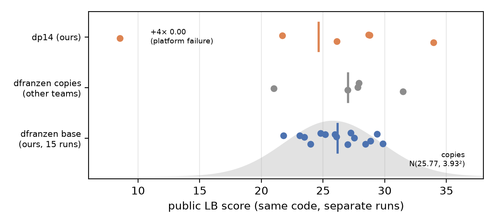

# Measuring Before Improving

### Variance, compute allocation and cache costs in an LLM harness for ARC-AGI-3

<!-- Kaggle Writeup body (limit 1,500 words; count with `python3 paper/wordcount.py`). The long version with all
tables is paper.md, attached as a PDF via the Project Link. Same release plan as paper.md: nothing public before
2026-11-03.
Cover image (Media Gallery, required): paper/fig/cover.png, 1600x800, made by paper/fig/cover.py. -->

**Submission:** ARC-AGI-3 submission 57374366 ([notebook `arc3-dp14`, version 1](https://www.kaggle.com/code/kazuhiro3381/arc3-dp14?scriptVersionId=359191772)), public LB 33.96 (best of six). **Long version and tools:** [repository](https://github.com/cacco2010-maker/arc3-measuring-before-improving).

## Summary

Most ARC-AGI-3 entries are forks of one public harness, and the leaderboard cannot tell them apart: our unchanged copy scored 21.8 to 29.9 over 15 identical runs. We measured how large an improvement must be to be visible, then built tools for smaller effects. Main results:

1. **Detectable effect:** ≈5 points, both for one 8-hour local evaluation (SE of a difference ±3.1) and for one leaderboard run (§1).
2. **A replay simulator** reproduces a real run to within 0.03 points without a GPU. Scheduler tunings worth +3 to +4 on their own trajectories are worth 0 or less on held-out ones (§2).
3. **Throughput as a one-hour proxy**, which led to 14 streams with a host-memory KV cache (§3).
4. **What memory costs:** appended summaries doubled prefill. A prefix-stable design removed that cost, yet the score did not recover: our own prediction failed (§4).
5. **A platform failure that scores 0.00** on four of our ten completed runs, and a keep-alive (§5).

## Setting

The base is dfranzen's Milestone-2 solution: Tufa Labs' Duck harness with Qwen3.8-Flash-Next (4-bit) on one RTX Pro 6000, where an LLM inspects frames through a Python tool and chooses actions. A priority scheduler gives the next GPU slot to one of ≈110 concurrent games. A game's context is trimmed from ≈117k to ≈57k tokens.

Our submission (`dp14`) changes two things: shiiin9's D′ priority formula, and 14 concurrent streams (was 10) with SGLang's hierarchical KV cache in 32 GB of host memory.

**Local evaluation** ("demo 25×4") plays the 25 public games 4 times each with the real per-game time budget and the official scorer. One costs 8 GPU-hours; we could afford one a week.

## 1. How big must an improvement be?

**Leaderboard.** Public copies of the base have a mean of 25.77 and an SD of 3.93 (Son Pham). Our 15 runs agree (26.18 ± 2.44). Against the copies' mean as a known control, one run needs +5 points for 90% one-sided confidence, and four runs need +2.5.

**Local.** Across the 4 passes of a game, the SD averages **16.5 points** (RMS 22). Between two versions, matched per-game differences swing by ±50 even when the means differ by only 1.7. The standard error of a 25×4 mean is ±2.2, and of a difference between two evaluations **±3.1**. Liang found a per-game SD of 24.0 between two identical two-pass runs; our RMS predicts 22.

**A weekly evaluation can only resolve effects of about 5 points, and most published tweaks are worth 1–2.** So we favoured changes that would be large if they worked, and low-noise proxies.

**All six of our evaluations (43.96–50.46) have an SD of 2.48, matching the ±2.2 noise (χ² p = 0.28): no change we tried is distinguishable from the base.**

*Figure 1. Public LB scores of identical code. Over six scored runs dp14 averages 24.63 (27.85 without an unexplained 8.53) against 26.18 for the base: the +4.0 local gain is invisible, as §1 predicts.*

## 2. Replaying the scheduler offline

**Simulator.** A trajectory is the sequence of a run's LLM requests (generated tokens, uncached input tokens, trims) and the points where it cleared levels. We assume a game's progress depends on the tokens and actions it consumes, not on wall-clock time. Request time fits t = 5.2 s + gen/59 + uncached/2100 (R² = 0.97). We replay any scheduler under the real budget. A run that the replay carries past its recorded end is **stitched**: it continues on another pass of the same game, from the same level. Passes that never cleared that level are included, so success rates are preserved.

**Validation.** Replaying D′ gives 50.43 against an actual 50.46; 99 of 100 runs reach the same level.

**Findings.**
- A future-knowing oracle reaches 53.33 against D′'s 50.61, so even perfect allocation is worth about +2.7.
- On the trajectories they were fitted to, the best scheduler settings gain **+3 to +4** in 18 of 20 game resamples.
- **On trajectories from two other evaluations (timing approximated), the same settings gain −2.6 and −1.3.**

With 100 trajectories, a scheduler fits their noise. Scoring a policy on the trajectories it was tuned on is as misleading as training-set accuracy, a trap the ARC Prize 2024 report also flagged. We rejected every allocation change.

## 3. Throughput as a proxy with little noise

Generated tokens per second barely varies between runs and takes 60 minutes to measure, so we screened server configurations on it:

| | 10 streams | 14 + host cache | 16 + host cache |
|---|---|---|---|
| Generated tok/s | 563 | **622 (+10.5%)** | 633 (+1.8%) |
| Mean KV utilisation | 0.54 | 0.65 | 0.78 |

The host cache appears to be what makes 14 streams pay at all. Without it, Liang's run lost 17 points as throughput collapsed to ≈280 tok/s. 14 streams with D′ scored **50.46** (base 46.49), the only change clearing our acceptance line, but that is the best of six and invisible on the leaderboard. Throughput measures compute, not score: the fastest evaluation (671 tok/s) scored 44.54.

## 4. What summarization actually costs

96 of 100 runs hit the context limit (median: at request 37), and each trim discards ≈59k tokens. We tested two memory designs, both with Python-state persistence: summaries appended every 24k tokens, and summaries replacing the history at about trim time ([`sumtrimB`](https://www.kaggle.com/code/kazuhiro3381/arc3-sumtrimb)).

| | dp14 | appended | replacing |
|---|---|---|---|
| Demo 25×4 | 50.46 | 43.96 | 44.54 |
| New prefill tokens | 60.6M | **122.1M** | 60.5M |
| Generated tok/s | 639 | 449 | **671** |
| Actions | 21,166 | 14,415 | 14,432 |
| Generated tokens/action | 890 | 918 | **1,365** |

Appended summaries mutate the shared prefix, so prefill doubled and throughput fell 30%. Summary tokens also lowered a game's priority: games losing ≥10 points received 49% of their former generation. We concluded that compute explained the loss, and predicted that a prefix-stable design would recover the score.

**The prediction failed.** Replacing summaries removed the whole compute cost, and losing games kept 90% of their generation. Trims are equally frequent but keep ≈56k tokens; replacements keep ≈8k. The score stayed at 44.54, as each action took 53% more tokens. Summaries themselves were ≈5% of tokens.

**Why.** Under a fixed budget, memory has two prices. Mutating a prefix is paid in prefill, whatever the summary's length. Compressing history is paid in re-checking. In 97 matched runs, tokens per action equal dp14's until the first replacement (1,049 vs 1,018), then diverge (1,469 vs 923). After a replacement, 85% of first responses open by re-grounding ("Let me re-ground"), against 7% in the appended design. About 90% of the excess is extra requests, not longer ones: inspection-only requests rise from 11% to 29%. The appended design shares Python persistence without the excess, so persistence is not the cause. Whether re-checking lowers the score is unproven; removing a compute cost does not show a mechanism helps.

Neither drop is proven: against dp14, itself the best of six, the 95% bootstrap intervals are −15.2 to +0.9 and −13.2 to +1.6.

## 5. A platform failure that scores 0.00

From mid-October, model loading on the evaluation machines slowed from ≈5 to ≈35 minutes, while the gateway ends a run after 15 minutes without an action. The harness sends one RESET after 12 minutes and then waits. **Four of our ten `dp14` submissions scored exactly 0.00.** Liang saw the same failure with the unmodified notebook, and Provorov measured 17 of 31 loads above 17 minutes.

**Keep-alive.** The game holding the first slot re-sends RESET every 9 minutes until the server is healthy, keeping the single shared scorecard, and stops at the first real action. A 14-game stub test confirms it. Its builds failed while mounting datasets; the rebuild missed the deadline. **It was never verified in a scored run.**

## What this means for reaching 85%

- **Evaluation is the bottleneck.** Progress needs more evaluations, held-out game collections, or mechanism-level proxies (throughput, token and cache accounting) instead of single scores.
- **Allocation is nearly exhausted** in this harness. Apparent scheduler gains are fitted noise.
- **The headroom is in what the model learns per token**, not in how tokens are spread: Provorov finds 46.5% of the attainable score in levels never reached. Memory must be costed in prefill and re-checking, not length.
- **Robustness is part of the score.** Start-up latency zeroed four of ten completed runs.

**Universality.** The variance analysis, replay with stitching, and the cache-cost argument apply to any LLM agent that runs long shared contexts under a fixed GPU budget.

## Code and license

Notebook Apache-2.0; tools (`sim/`, `_make_nb.py`, keep-alive cells) CC0. Built on dfranzen's harness (Apache-2.0), Tufa Labs' Duck harness, shiiin9's D′ (Apache-2.0) and Qwen3.8-Flash-Next (Qwen Community License); full licenses in the long version.

**References.** dfranzen, ARC-AGI-3 Milestone 2 Solution; Tufa Labs, duck-harness; shiiin9, D′ scheduler; Son Pham, discussion/745062; F. Liang, discussion/750885; T. H. Kang, discussion/744792; skarin, 100-Trajectory Audit; A. Provorov, The Book of Ideas; ARC Prize 2024 Technical Report.
